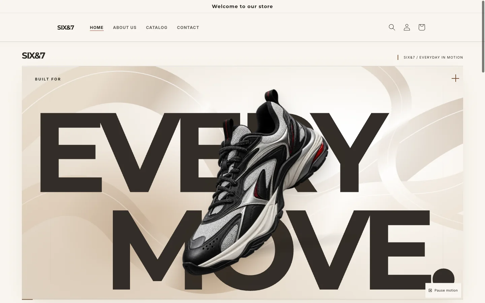
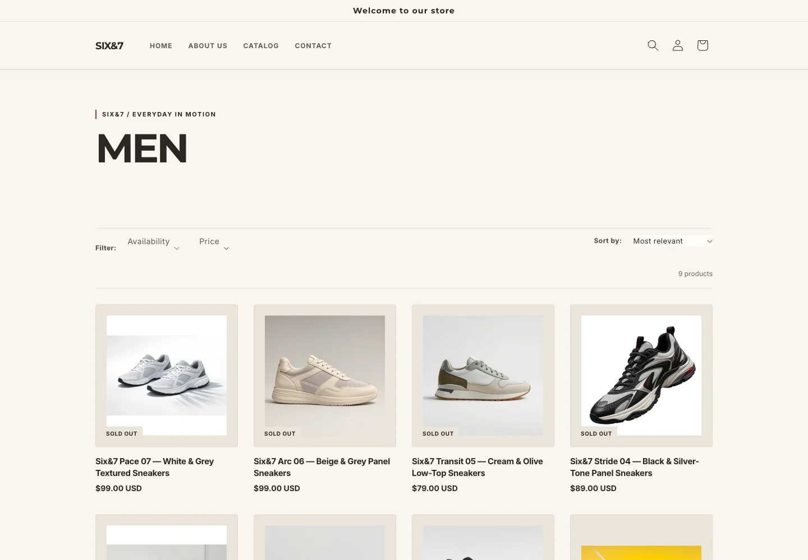
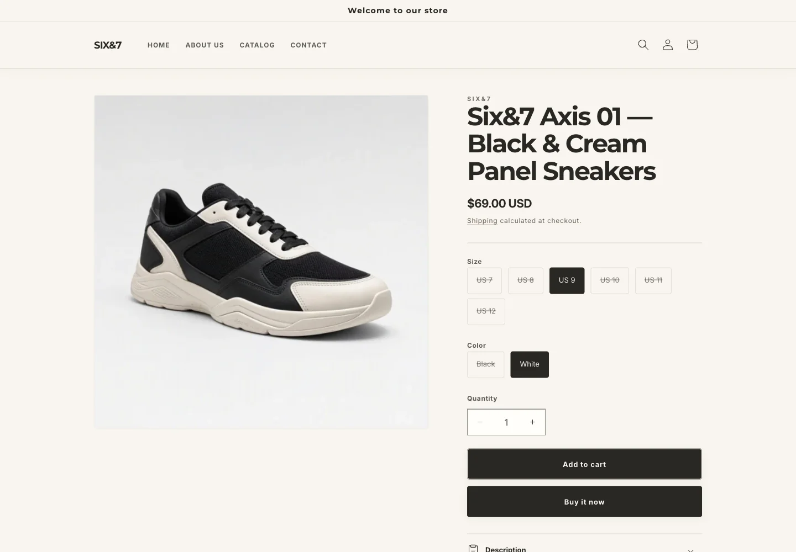
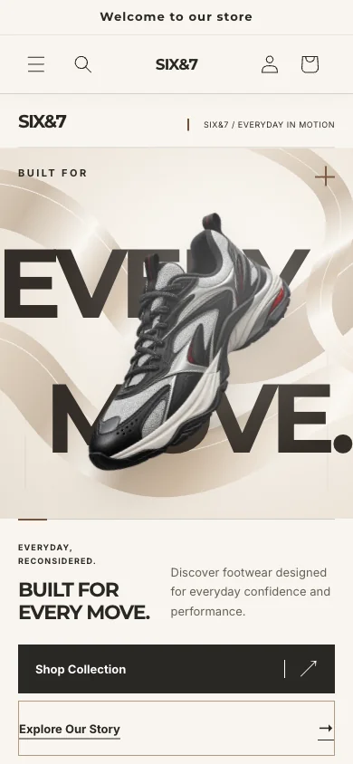
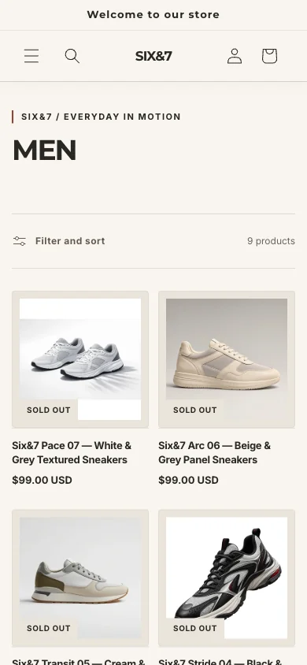
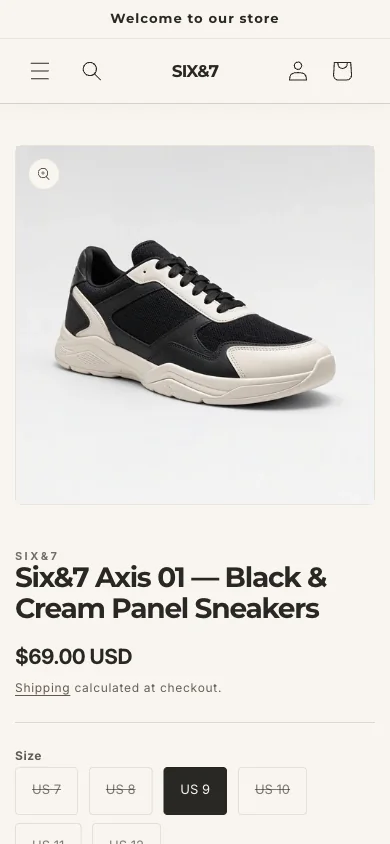

# SIX&7 — Everyday in motion

**A footwear storefront built with Shopify Liquid, Dawn and a custom cream motion design.**

Oversized editorial typography. A floating sneaker hero. Warm neutral surfaces and a responsive catalog that keeps Shopify’s native product and cart behavior at its core. Six&7 brings a distinct visual identity to an Online Store 2.0 theme while preserving merchant editing through sections, blocks and global settings.



**Dawn 16.0.0 · Online Store 2.0 · Liquid · CSS · Vanilla JavaScript**

[Explore the build](#the-build) · [View the gallery](#storefront-gallery) · [Development](#development) · [Verification](#verification)

> Genuine browser imagery from **17 October 2026**, optimized for this documentation refresh on **20 October 2026**. These are historical Shopify preview captures, not a local render or newly captured live storefront. See the [capture manifest](docs/screenshots/manifest.json).

## The build

Six&7 is a Shopify theme customization project focused on visual design, reusable Liquid components, responsive layouts and progressive motion. The checked-in theme identifies its foundation as **Shopify Dawn 16.0.0** in `config/settings_schema.json`.

| Custom implementation | What it adds |
| --- | --- |
| Editorial hero | Oversized “EVERY MOVE” composition, merchant-selected imagery, two calls to action and configurable poster copy |
| Cream motion system | Warm surface colors, ambient floating, opposing scroll layers, pointer lighting and restrained card tilt |
| Category stories | Editable Men, Women, Kids and Sports cards with responsive editorial placement |
| Branded storefront | Custom header, collection presentation, product styling, About composition and footer |
| Product information | Reusable disclosure rows for policy or merchant-provided content, with editor guidance when empty |
| Portfolio controls | Optional concept catalog and unpublished-product guards; concept sections are disabled in the current homepage and collection templates |
| Motion accessibility | Reduced-motion handling, visible keyboard focus, a hero pause control and content that remains visible without animation |

### Native commerce and third-party boundaries

Shopify and Dawn provide product data, variants, availability, media galleries, predictive search, collection filters and sorting, cart interactions and checkout entry. This repository customizes their presentation; it does not implement a separate commerce backend or payment processor.

**Judge.me** app embed and product review blocks are configured in the source. Their runtime behavior depends on the store’s app installation and settings; no new reviews or app functionality were tested during this documentation run.

The October 17 release record reported 30 products published to the Online Store, native product/cart interaction checks and configured policy routes. These are dated store observations, not catalog contents bundled with this repository or a guarantee of present availability. Twelve products were recorded without authentic product imagery. Product fit, size/color accuracy, payment processing and fulfillment readiness remain outside this portfolio’s verified scope.

## Design system

| Element | Implementation |
| --- | --- |
| Background | Warm cream `#F8F5EF` |
| Text | Deep charcoal `#292724` |
| Secondary surface | Sand `#EAE4DB` |
| Border and muted text | `#D8D0C6` and `#665F57` |
| Accent | Warm brown `#775238`, with muted red details |
| Typography | Montserrat headings and Inter body text in the current merchant settings |
| Layout | Dawn containers and grids, custom hero layers and category compositions |
| Responsive behavior | Mobile category layout below 750px, adaptive product grids, native mobile navigation and restrained motion on touch layouts |

The shared `six7-tokens.css` defines base tokens. The cream overrides in `six7-cream-motion.css`, loaded by `layout/theme.liquid`, establish the current palette. Typography remains connected to Shopify’s font settings. Fine-pointer effects progressively enhance the layout; reduced-motion preferences suppress movement.

## Storefront gallery

### Collection and product — desktop

| Native collection grid | Native product page |
| --- | --- |
|  |  |

### Mobile experience

| Homepage · 390px | Collection · 390px | Product · 390px |
| --- | --- | --- |
|  |  |  |

The hero is from the approved Draft release; internal pages and the mobile homepage are from the earlier October 17 Cream Motion Lab review. The mobile image illustrates the cream composition before the final V2 motion refinement. Displayed prices and availability reflect the captured selections and date. The hero’s lower preview toolbar was cropped; the other images retain the original viewport composition. All six assets are genuine screenshots converted to WebP, with no generated storefront imagery or replacement product assets.

Fresh captures were blocked by the anonymous storefront password gate. Full-homepage, featured-product, tablet, mobile-navigation and cart screenshots are therefore not included. The older `portfolio-delivery/` package remains a historical concept-stage record and is not the current showcase.

## Liquid architecture

```text
assets/       Dawn components, Six&7 styles and motion controller
config/       Theme settings schema and merchant configuration
layout/       Shared document shell and asset loading
locales/      Theme translation resources
sections/     Editor-configurable hero, categories, catalog and page sections
snippets/     Reusable cards, navigation helpers and product information
templates/    Online Store 2.0 JSON page compositions
docs/         Optimized screenshot gallery and capture provenance
```

| Source | Responsibility |
| --- | --- |
| `layout/theme.liquid` | Global shell, theme fonts, metadata and cream motion assets |
| `sections/six7-hero.liquid` | Hero content, media, poster and motion settings |
| `sections/six7-categories.liquid` | Editable category blocks |
| `sections/featured-collection.liquid` | Native Shopify collection rendered as “THE LINEUP” |
| `sections/six7-about.liquid` | Branded About page composition |
| `sections/main-product.liquid` | Dawn product experience with reusable custom information rows |
| `snippets/six7-product-accordion.liquid` | Shared product disclosure markup |
| `snippets/six7-navigation-url.liquid` | Consistent About routing |
| `snippets/six7-demo-*.liquid` | Optional historical concept presentation and unpublished-product guard |
| `assets/six7-cream-motion.css` / `.js` | Cream styling and motion enhancements, including theme-editor and reduced-motion handling |

JSON templates compose sections; section schemas expose merchant controls; snippets keep shared Liquid markup reusable. Shopify supplies the runtime objects, routes, menus, products, policies and app rendering. They cannot be reconstructed from the theme files alone.

## Technology

| Layer | Stack |
| --- | --- |
| Rendering | Shopify Liquid and JSON templates |
| Presentation | Semantic HTML, CSS, SVG and Shopify-hosted media |
| Interaction | Vanilla JavaScript, Dawn custom elements, Web Animations and observer APIs |
| Merchant tooling | Online Store 2.0 section schemas, blocks and theme settings |
| Local verification | Shopify CLI Theme Check, Node syntax checks, JSON/schema parsing and Git checks |

## Development

Clone the source and work from the repository root:

```sh
git clone https://github.com/sahilbhardwaj037037-sys/six7-shopify-store.git
cd six7-shopify-store
```

Use an existing Shopify CLI installation for Theme Check and Node.js for JavaScript syntax checks. The commands below use a POSIX shell. There is no root `package.json` or frontend dependency installation step. No dependencies were installed for this refresh.

Keep private backups and reports out of the validation directory:

```sh
THEME_CHECK_DIR=$(mktemp -d /tmp/six7-theme-check.XXXXXX)
for directory in assets config layout locales sections snippets templates; do
  cp -R "$directory" "$THEME_CHECK_DIR/"
done
shopify theme check --path "$THEME_CHECK_DIR" --no-input
for script in assets/*.js; do
  node --check "$script" || break
done
git diff --check
```

Theme Check is static analysis, not a local storefront server. A faithful rendered preview requires Shopify’s Liquid runtime plus store data and uploaded media; no isolated renderer is supplied here. This documentation run did not start a connected-store development server, upload a theme, submit a form or initiate checkout.

### Theme customization

1. Edit hero copy, imagery, links and motion controls through the **Six7 hero** section settings.
2. Configure the four category blocks and their collection selections through the category section.
3. Choose the featured collection, product count and card presentation in the homepage featured collection section.
4. Use global font, navigation and cart settings for Dawn’s native controls. Current configuration uses cart notifications.
5. Configure product information blocks and About content in their corresponding templates. Preserve Judge.me app blocks and all existing section setting IDs.

Product records, menus, collections, files and policies belong to the store. `shopify://` media references need the corresponding uploaded assets, and the optional concept catalog is a manually maintained snapshot. Keep credentials outside version control. Review merchant configuration before any separately authorized platform release.

## Demo and publication status

The latest local release evidence, dated October 17, identifies **Six&7 Draft** as unpublished and **Horizon** as the protected live theme. This documentation refresh did not reauthenticate to Shopify or independently recheck Admin state. The [storefront entry](https://sixseven-practice.myshopify.com/) requires a password for anonymous access as checked on October 20; a public working demo is not claimed.

GitHub publication distributes source and documentation. It does **not** automatically synchronize this theme with Shopify. No deployment workflow is configured in this repository, and no Shopify deployment was performed for this refresh.

## Verification

| Check | October 20 documentation run |
| --- | --- |
| Theme Check on isolated theme-only copy | **0 errors, 9 warnings** |
| Theme JSON | **68 files parsed** |
| Liquid section schemas | **42 schemas parsed** |
| JavaScript syntax | **37 assets passed `node --check`** |
| Credential-pattern scan of tracked text | **No matching credentials found**; targeted scan, not a security certification |
| Screenshot review | Six images inspected for visible private data and broken media; WebP files decoded and relative README image paths checked |
| Whitespace | `git diff --check` |

The nine Theme Check warnings concern `LiquidComplexity`, `OrphanedSnippet`, `UndefinedObject`, `UnusedAssign` and `VariableName`. No theme code fixes were needed for this documentation change. Merchant rich text, policy HTML and app rendering still require the platform’s intended trust model; no broad rendering changes were made.

Earlier October 17 browser evidence records navigation, search, filters, sorting, product media, stock-state controls, cart add/update/remove, keyboard focus, reduced motion and responsive checks at **390, 768 and 1440px**. These were not rerun today. **320px layout, fresh horizontal-overflow checks and current browser console behavior remain unverified** because a safe anonymous rendered preview was unavailable. No payment, order, contact or newsletter submission was performed in this run.

## Credits and licensing

Theme foundation: [Shopify Dawn](https://github.com/Shopify/dawn), version 16.0.0. **Copyright (c) 2021-present Shopify Inc.** Dawn is distributed under its [upstream license and use conditions](https://github.com/Shopify/dawn/blob/v16.0.0/LICENSE.md); preserve the applicable copyright and permission notices when redistributing Dawn-derived code. This project does not declare a separate license for its custom additions.

Six&7 branding, custom Liquid presentation and cream motion work are part of this portfolio project. Judge.me belongs to its respective provider. Store-hosted footwear and editorial images are shown as project content; this repository does not grant independent reuse rights to those assets. Current category settings reference Pexels-named media; confirm original source and usage rights before reusing that photography elsewhere.
